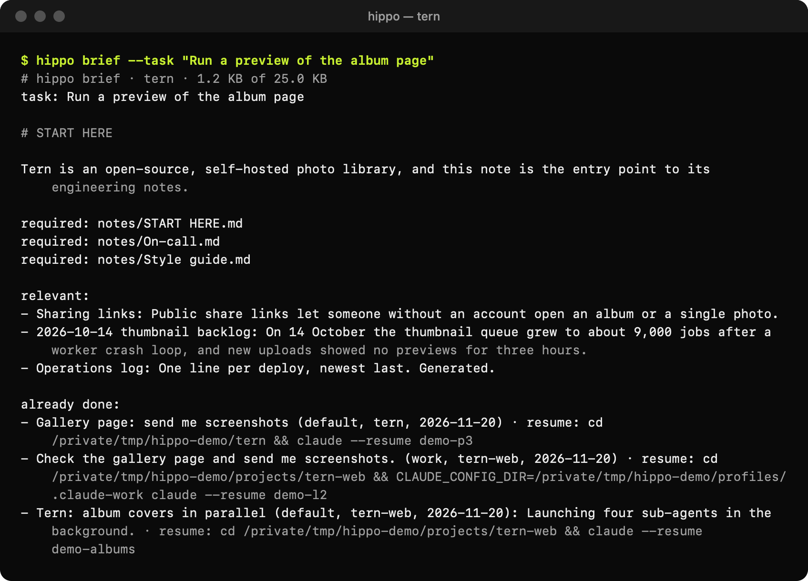
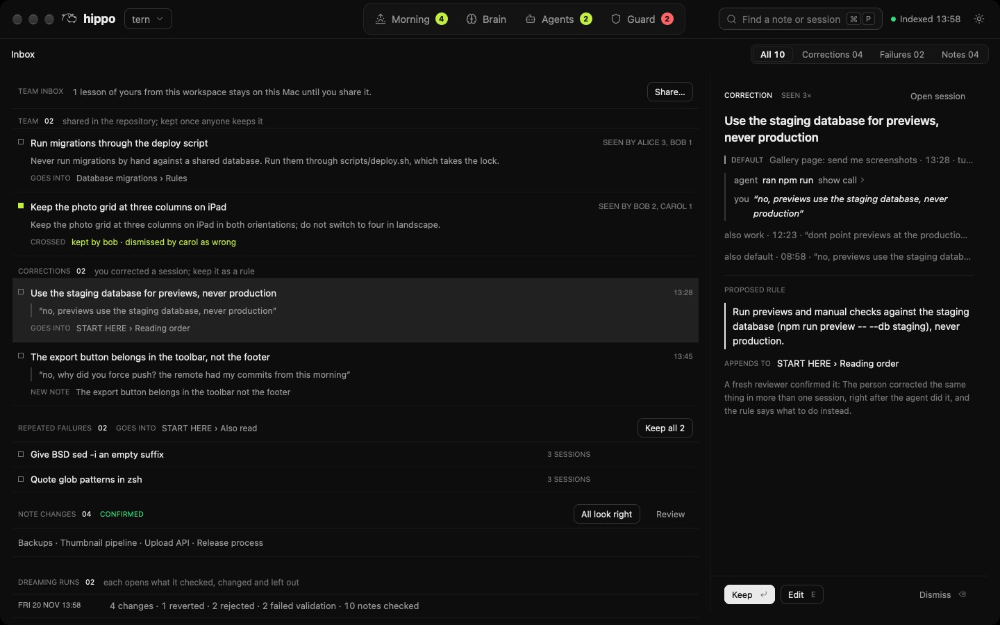
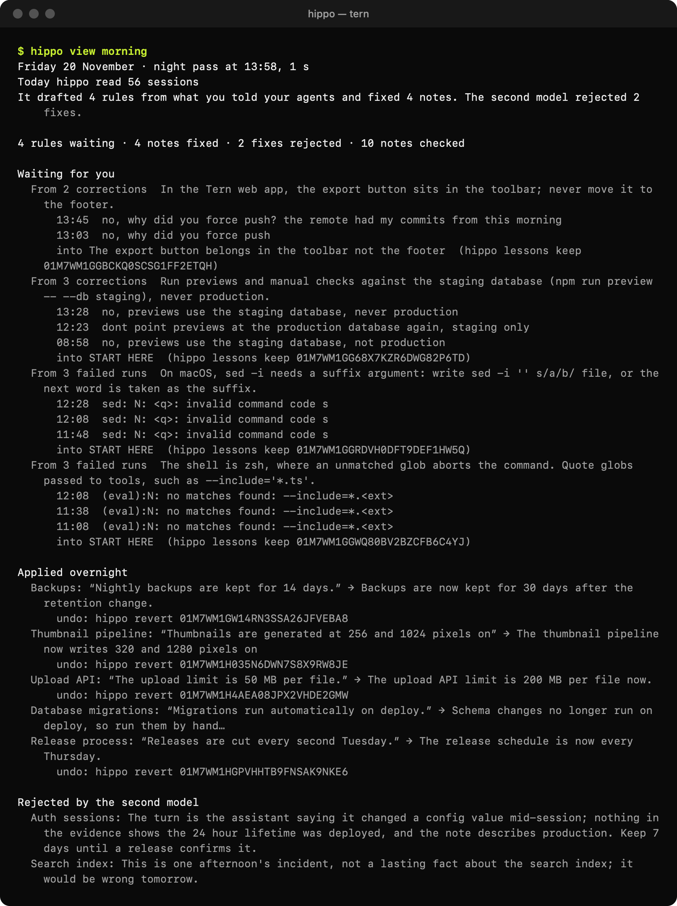
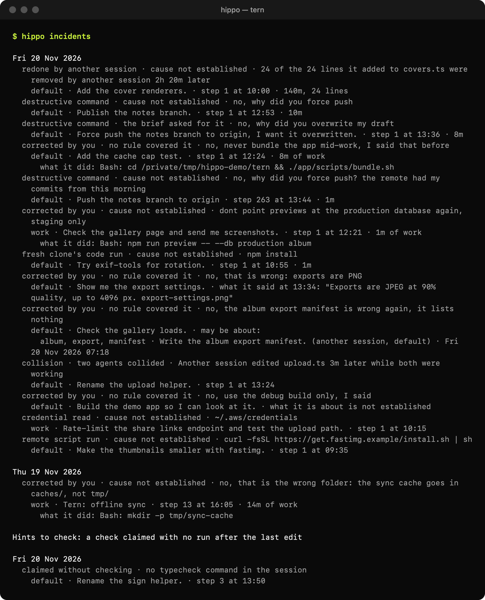
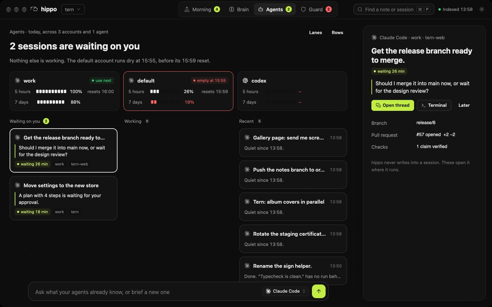
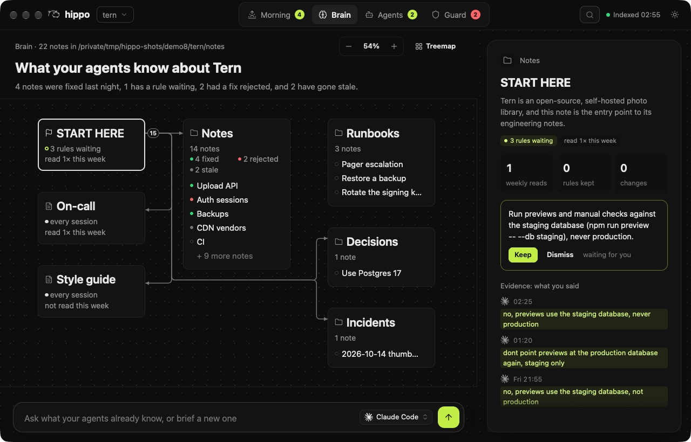
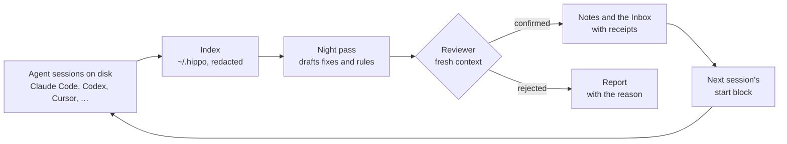

<div align="center">

<picture>
  <source media="(prefers-color-scheme: dark)" srcset="brand/hippo-mark-dark.svg">
  
</picture>

# hippo

**Your coding agents learn while you sleep.**

hippo reads every session your coding agents leave on your machine, turns what you had to correct into rules a second model checks against what happened, and starts each new session with the notes its task needs.

[](#install)
[](#install)
[](docs/mcp.md)
[](https://github.com/VanitasCaesar1/hippo/actions/workflows/ci.yml)
[](CHANGELOG.md)
[](LICENSE)
[](docs/is-it-safe.md)

[Install](#install) · [Quick start](#quick-start) · [Compared](#hippo-claude-codes-memory-or-) · [Features](#features) · [How it works](#how-it-works) · [Is it safe?](docs/is-it-safe.md) · [Docs](https://vanitascaesar1.github.io/hippo/) · [FAQ](#faq)

</div>

<!-- Screenshot: Hippo.app's Morning on the synthetic demo project (v0.7.2, new palette). -->
<p align="center"><b><a href="https://vanitascaesar1.github.io/hippo/demo.html">Try the live demo</a></b>: Hippo.app's Morning and Brain in your browser, on made-up data.</p>

## Why hippo

Every session starts from zero, and each agent keeps its own memory, if any. You correct the same mistake on Tuesday that you corrected on Monday, in another agent.

- **If you use one agent:** you stop repeating yourself. Correct it twice and hippo drafts the rule; you keep it or dismiss it, and the next session starts with it.
- **If you run several agents or accounts:** Claude Code, Codex, Cursor and the rest read the same notes and the same rules, and you can ask whether any of them already solved what you are about to start.
- **If you work in a team:** the notes are Markdown in your repository, every change has a receipt, and rules can go through a shared Inbox in git that each person keeps or dismisses.

## hippo, Claude Code's memory, or …?

Each of these is worth knowing; they answer different questions.

| | **hippo** | **Built-in agent memory** (Claude Code `CLAUDE.md` and auto-memory, Cursor rules and memories, Codex `AGENTS.md`) | **[claude-mem](https://github.com/thedotmack/claude-mem)** | **[Basic Memory](https://github.com/basicmachines-co/basic-memory)** |
|---|---|---|---|---|
| **What it is** | Memory built nightly from every agent's transcripts, kept in your notes folder | A file or store each agent reads at start | A worker that turns each session's tool activity into observations with a second agent | A Markdown knowledge base that AI and people read and write through MCP |
| **Who writes it** | Drafted from what happened; a second model confirms each change; you keep each rule | You, or the agent when it decides to | The observer agent, as you work | You and the AI, in the same files |
| **Checked against what happened** | Yes: a fresh-context reviewer must confirm, with cited turns | No | Not described in its README | Not its aim |
| **Across agents** | Reads 8 agents' history; 6 get the start block; any MCP client can ask | Each agent has its own | Several agents, per its README (Claude Code, Codex, OpenCode, Gemini and more) | Any MCP client |
| **Where it lives** | `~/.hippo` and your repository's notes, plain files | The agent's own files | `~/.claude-mem` (SQLite), cloud sync opt-in; usage analytics on by default, per its README | Markdown on your disk; cloud optional |
| **Undo** | A receipt and a snapshot per change, `hippo revert` | git, if committed | Not described in its README | Your files and git |
| **Cost** | Model calls each night under your own agent login | Nothing extra | An observer model per its setup; a paid observer is offered | Free locally; paid cloud offered |

**Pick hippo** when you want what your agents learn checked before it lands, shared across agents, and undoable. **Pick your agent's built-in memory** when one agent and a hand-kept file are enough. **Pick claude-mem** when you want every session's activity captured and searchable without keeping notes yourself. **Pick Basic Memory** when you want a knowledge base you and the AI write together. They combine: hippo reads whatever notes folder you point it at.

## Features

<table>
<tr>
<td width="33%" valign="top"><b>A night pass with a reviewer</b><br>Each night a model reads the day's sessions and drafts note fixes and rules; a second model with a fresh context must confirm each one against the turns it cites.</td>
<td width="33%" valign="top"><b>An Inbox, not autopilot</b><br>Rules drafted from your corrections and from repeated failures wait for you to keep, edit or dismiss; nothing becomes a rule on its own.</td>
<td width="33%" valign="top"><b>A start block per task</b><br>A new session gets the entry note, the required notes and the notes its task needs, about 1.5 KB under a hard budget, not the whole pile.</td>
</tr>
<tr>
<td valign="top"><b>Every agent, and MCP</b><br>Reads Claude Code, Codex, Cursor, Gemini CLI, OpenCode, DeepSeek Harness, Muse Code and Command Code; any MCP client can ask through <code>hippo mcp</code>.</td>
<td valign="top"><b>Guard and secrets</b><br>Flags, by rule and with no model, an agent piping an installer from the internet, reading a credential file or running a fresh clone's code; secrets are redacted before anything is indexed.</td>
<td valign="top"><b>Receipts and revert</b><br>Every applied change has a receipt and a snapshot; <code>hippo revert &lt;receipt&gt;</code> puts the note back.</td>
</tr>
</table>

## See it in action

Taken from the synthetic demo project in this repository (`app/scripts/demo-home.sh`), not anyone's real work. The app screenshots follow your light or dark setting. The [live demo](https://vanitascaesar1.github.io/hippo/demo.html) runs Morning and Brain in the browser.

<table>
<tr>
<td width="50%" valign="top"><br><code>hippo brief</code>: what a new session on a task starts with, and the past sessions that already did part of it.</td>
<td width="50%" valign="top"><picture><source media="(prefers-color-scheme: light)" srcset="docs/assets/readme/app-inbox-light.jpg"></picture><br>The Inbox: rules drafted from your corrections and repeated failures, and the team's, waiting for you.</td>
</tr>
<tr>
<td width="50%" valign="top"><br>A night pass's report: the rules it drafted, what it changed (each with an undo) and what the second model rejected, with its reason.</td>
<td width="50%" valign="top"><br><code>hippo incidents</code>: what went wrong, in which session and at which step, and whether a rule covered it.</td>
</tr>
<tr>
<td width="50%" valign="top"><picture><source media="(prefers-color-scheme: light)" srcset="docs/assets/readme/app-agents-light.jpg"></picture><br>Agents in Hippo.app: who waits on you, who is working, and which account runs dry before its reset.</td>
<td width="50%" valign="top"><picture><source media="(prefers-color-scheme: light)" srcset="docs/assets/app-brain-light.jpg"></picture><br>Brain in Hippo.app: the notes as a map, with what was fixed last night, what waits and what went stale.</td>
</tr>
</table>

## Install

**Claude Code plugin.** In a Claude Code session:

```text
/plugin marketplace add VanitasCaesar1/hippo
/plugin install hippo@hippo
```

then `/hippo:setup`. It installs the binary if it is missing (after asking), sets up the notes folder and Claude Code's hooks, indexes your history, and offers the nightly schedule. No terminal needed.

**Codex plugin.** In the Codex app: Plugins › Add a marketplace › `VanitasCaesar1/hippo`, then **+** on hippo. Or from a terminal:

```sh
codex plugin marketplace add VanitasCaesar1/hippo
codex plugin add hippo@hippo
```

then ask Codex to *set up hippo for this project* (the `$hippo` skill does the same first run).

**One line.** macOS (Apple silicon or Intel) or Linux (x86_64 or arm64), no `sudo`, into `~/.local/bin`, checked against the published sha256:

```sh
curl -fsSL https://raw.githubusercontent.com/VanitasCaesar1/hippo/main/install.sh | sh
curl -fsSL https://raw.githubusercontent.com/VanitasCaesar1/hippo/main/install.sh | sh -s -- --app   # and Hippo.app, on macOS
```

Hippo.app is signed ad hoc, not notarised; `hippo app install` fetches it the way that opens without a prompt ([Install › Hippo.app](docs/site/src/install.md#hippoapp-macos)).

**Homebrew.** There is no tap yet. Each release carries a filled formula, `hippo.rb`, which you can put in a tap of your own: `brew tap-new $USER/local && curl -fsSL https://github.com/VanitasCaesar1/hippo/releases/latest/download/hippo.rb -o "$(brew --repo $USER/local)/Formula/hippo.rb" && brew install $USER/local/hippo`.

**Cargo.** `cargo install --locked --git https://github.com/VanitasCaesar1/hippo hippo` (Rust 1.89 or later). DeepSeek Harness and OpenCode have their own plugins: [dsh](plugins/dsh/README.md), [OpenCode](plugins/opencode/README.md); Cursor, Gemini CLI and MCP clients: [Install](docs/site/src/install.md).

## Quick start

1. **Set up the project.** `/hippo:setup` in Claude Code, `$hippo` in Codex, or in a terminal `hippo setup --yes` from the project (it prints the steps first without `--yes`).
2. **Start a new session.** It begins with hippo's start block. For Codex, trust hippo's hooks when Codex lists them.
3. **Let it run a night.** `hippo schedule install` indexes every 10 minutes and runs the night pass at 03:30; in the morning, open the Inbox (`hippo lessons`, or Morning in Hippo.app).

### Things to try

| Ask your agent | Or ask hippo |
|---|---|
| "Has any agent already solved the flaky upload test?" | `hippo ask --sources-only "flaky upload test"` |
| "What did the agents do yesterday?" | `hippo` or `hippo show day 2026-11-19` |
| "Brief a new session on the album export" | `hippo brief --task "album export"` |
| "What's waiting in my hippo Inbox?" | `hippo lessons` |
| "Did any agent do something risky this week?" | `hippo incidents` |

## How it works



Ingest reads each agent's transcripts where the agent already writes them and keeps a local SQLite index, with secrets redacted by pattern. The night pass gives a model the day's sessions and your notes, as untrusted data, and asks for changes that cite the turns behind them. A second model, which never sees the first one's reasoning, confirms or rejects each. Confirmed note fixes are applied with a receipt and a snapshot; rules wait in the Inbox for you. A new session's hook asks hippo for the start block. More: [Architecture](docs/site/src/architecture.md).

## What it adds to your project

- `notes/` (or the folder you choose), with `START HERE.md` if you had none: plain Markdown you own.
- `.hippo/`: the workspace's settings and packs, plus per-person records (sessions, proposals, receipts, snapshots) that its own `.gitignore` keeps out of git.
- A line in `.gitignore` and one in `.gitattributes` (a union merge for notes). hippo never commits, pushes or adds anything.
- Claude Code's hooks go in `.claude/settings.local.json`, which is personal and not committed.

## Privacy

hippo's own code has no HTTP client and sends nothing. Data leaves your machine only through programs you already use: the model command for the night pass and written answers (by default `claude -p`, under your own login, with no tools), git when you fetch a pack, and curl when you install or update. Transcripts are redacted when indexed. Exactly what runs, reads and writes: [Is it safe?](docs/is-it-safe.md).

## Status

One person's project, used daily on macOS on Apple silicon and tested on Linux in CI, not used there day to day. Scheduling is launchd on macOS; elsewhere `hippo schedule install` prints cron and systemd lines. Hippo.app is macOS only and early. Muse Code and Command Code sessions are read but not given the notes. Whether the night pass makes agents' work better is not measured. No pack by another author exists yet. The full list: [Limits and known gaps](docs/site/src/limits.md).

## Documentation

| | |
|---|---|
| [Install](docs/site/src/install.md) | Every agent, the plugins, Hippo.app |
| [Quick start](docs/site/src/quick-start.md) | From nothing to a briefed session |
| [Commands](docs/site/src/commands.md) | Every command and flag |
| [Is it safe?](docs/is-it-safe.md) | Hooks, programs, network, checksums |
| [Concepts](docs/site/src/concepts.md) and [Architecture](docs/site/src/architecture.md) | How it fits together |
| [Sharing in a team](docs/site/src/sharing.md) | One brain through git |
| [Packs](docs/site/src/packs.md) | Night-pass passes you copy and own |
| [Limits](docs/site/src/limits.md) | What it does not do yet |

## FAQ

<details><summary><b>Is it safe?</b></summary>

hippo installs hooks in your agents and runs a model at night, so the full list is written down: every hook and when it fires, what each reads and writes, every program hippo starts, the network, and what it never does, in [docs/is-it-safe.md](docs/is-it-safe.md). A test fails when a new hook, MCP tool, program or outbound host appears without that page changing.
</details>

<details><summary><b>Does my code leave my computer?</b></summary>

Only through the model command you configure, which for the night pass and written answers is by default your own `claude -p`; it gets session excerpts and notes, with secrets redacted. `hippo ask --sources-only`, `brief`, `incidents`, the hooks and the app send nothing.
</details>

<details><summary><b>What does it cost?</b></summary>

hippo is free and MIT. The night pass makes model calls under your own agent login, so it counts against that account; how many depends on how many sessions the day had. `hippo dream --dry-run` shows what a pass would propose.
</details>

<details><summary><b>Will it change or commit my files?</b></summary>

It never commits, pushes or adds to git. A confirmed night-pass change edits a note in your notes folder, with a receipt and a snapshot (`hippo revert` undoes it). A rule lands only when you keep it. Setup writes the files listed under [What it adds to your project](#what-it-adds-to-your-project).
</details>

<details><summary><b>Does it work with my agent?</b></summary>

Sessions are read from Claude Code, Codex, Cursor, Gemini CLI, OpenCode, DeepSeek Harness, Muse Code and Command Code. Claude Code, Codex, Gemini CLI, Cursor, OpenCode and dsh get the start block; any MCP client (Windsurf, Zed, VS Code, Claude Desktop, …) can ask through `hippo mcp`. See [Install](docs/site/src/install.md).
</details>

<details><summary><b>Teams?</b></summary>

Through git: the notes and receipts are files in the repository, what your own agents did stays ignored, and a shared Inbox lets each person keep or dismiss a teammate's rule. Nothing syncs live. [Sharing a brain in a team](docs/site/src/sharing.md).
</details>

<details><summary><b>Does it make agents better?</b></summary>

Not measured. On the repository's eval set with a real model, the night pass fixed 3 of 7 planted errors and damaged 0 of 8 correct notes; on the maintainer's own notes it has fixed 7 wrong statements, each checked by hand. hippo is one person's project, used daily on macOS; Linux is tested in CI.
</details>

## Contributing and licence

[`CONTRIBUTING.md`](CONTRIBUTING.md) · [`CODE_OF_CONDUCT.md`](CODE_OF_CONDUCT.md) · security reports through [private vulnerability reporting](SECURITY.md) · [Roadmap](ROADMAP.md) · [Changelog](CHANGELOG.md). MIT. The card's embedded DejaVu fonts are under their own [licence](crates/hippo/assets/fonts/LICENSE-DejaVu.txt). The hippo mark is © Vanitas Caesar and may be used to refer to this project.
