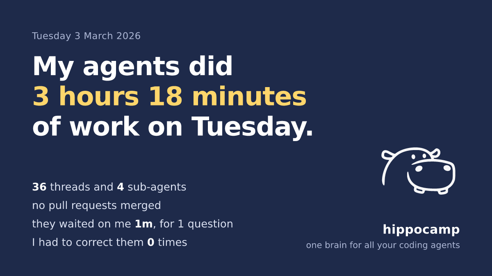

<p align="center">
  <picture>
    <source media="(prefers-color-scheme: dark)" srcset="brand/hippo-mark-dark.svg">
    
  </picture>
</p>

<h1 align="center">hippo</h1>

<p align="center"><b>One brain for all your coding agents.</b></p>

Your Claude Code sessions start from the same plain-Markdown notes and write back to them, and at night a second, fresh-context reviewer checks every proposed change to those notes against what your agents actually did. Underneath, hippo indexes every Claude Code, Codex and DeepSeek Harness (`dsh`) session on your machine, so you can search them, see your agents' day, and share it.

<p align="center"></p>

<p align="center"></p>

<p align="center"><sub>Both from synthetic data. The card shows numbers and a date, never a project, title or path.</sub></p>

## Install

macOS (Apple silicon or Intel) or Linux (x86_64 or arm64), one line, no `sudo` (installs to `~/.local/bin`):

```sh
curl -fsSL https://raw.githubusercontent.com/VanitasCaesar1/hippo/main/install.sh | sh
```

Inside Claude Code, as a plugin (then run `/hippo:setup`):

```text
/plugin marketplace add VanitasCaesar1/hippo
/plugin install hippo@hippo
```

With Rust 1.89 or later: `cargo install --locked --git https://github.com/VanitasCaesar1/hippo hippo`.

Inside DeepSeek Harness (`dsh`), as a plugin that gives sessions the same start block and lets the model call `hippo ask` and `hippo show day`: `dsh plugin --profile web add "github:VanitasCaesar1/hippo#v0.2.1&path:/plugins/dsh"` ([details](plugins/dsh/README.md)).

## The first two minutes

```sh
hippo                  # lists the agent history it finds; nothing is written yet
hippo start --yes      # indexes it (history only, nothing sent), then shows your last active day
hippo card             # that day as a 1200 x 675 PNG to share, and the same lines as text
```

The overview gives the day's sessions and sub-agents, the agents' work time, how long they waited on you, the pull requests they merged, the times you corrected them (the first one quoted), the busiest sessions, and four commands to try next. It reads `~/.claude*/projects`, `~/.codex/sessions` and `~/.dsh/sessions`; `hippo start --add-root <dir>` adds another folder.

## What it does

1. **Search every past session.** `hippo ask --sources-only "<question>"` ranks the past sessions that dealt with it, with the command to resume each; without `--sources-only` it also writes an answer that cites them. `hippo recall "<words>"` searches every indexed turn.
2. **See the day.** `hippo` shows the last active day; `fleet` today's sessions (live, waiting on you, stopped at a usage limit); `incidents` what went wrong and at which step; `xray <session>` what context a session was given and what it used; `card` the day, or `--week`, as one image.
3. **A shared brain your agents start from and write back to.** `hippo init --notes-dir notes --entry-note "notes/START HERE.md"` sets up a notes folder; `hippo hooks install` gives every Claude Code session in it the notes at start and keeps a record of each session; `hippo brief --task "<task>"` is the start block for any agent, with the past sessions that already did part of it.
4. **Kept true at night, with a second reviewer and an undo.** `hippo dream` checks notes against transcripts and folds finished sessions' handoffs into them. A second model run that never sees the first one's reasoning must confirm each change; every applied change has a receipt and a snapshot, and `hippo revert <receipt>` undoes it. `hippo schedule install` runs it nightly.
5. **Packs you copy and own.** `hippo add <path or git URL>` copies a pack of dreaming passes, prompts and reviewer personas into your workspace after a fresh-context review; it is plain files, never code, and `hippo packs update` merges upstream changes without losing your edits.

## How it differs

- **Your notes are files.** Plain Markdown in your own folder: read them, edit them, commit them. The index is a local SQLite file you can delete and rebuild.
- **No change lands without a fresh-context review.** The model that proposes a change never grades it.
- **Every change can be undone.** A snapshot and a receipt per change, and one command to revert it.

## What leaves your machine

hippo's own code makes no network calls: it has no HTTP client. Data leaves only through two kinds of child process it starts:

- **The model command**, by default `claude -p` under your own login, run by `dream` (also `--dry-run`), `lessons scan`, `ask` without `--sources-only`, the pack review in `add` and `packs update`, `eval --with-model`, `doctor --model`, and the scheduled dream.
- **Git**, to fetch a pack: `add` from a URL or a registry, `packs update`, and `packs diff` of a git pack.

Everything else, including `hippo`, `start`, `card`, `recall`, `ask --sources-only`, `fleet`, `incidents` and `xray`, is local. Transcript text is redacted on ingest (keys, tokens, emails and more, by pattern; best effort). Details: [Security and privacy](docs/site/src/security.md).

## What it does not do yet

- **Claude Code, Codex and DeepSeek Harness only.** OpenCode and Cursor folders are detected, not read. Claude Code gets the notes at session start through hooks or its plugin, and a dsh session through [its plugin](plugins/dsh/README.md); a Codex session is indexed and searchable, and can run `hippo brief` itself if your instructions ask it to.
- **Scheduling** is launchd on macOS. Elsewhere `hippo schedule install` prints cron and systemd lines for you to install.
- **Linux is tested in CI, not in daily use.** The release has static Linux binaries (x86_64 and arm64) and the test suite passes on Linux in CI, but hippo is used day to day on macOS on Apple silicon (the Intel build passes the first-run check under Rosetta).
- **The desktop app**, Hippo.app in [`app/`](app/README.md), is macOS only, built from source, and early: checked on synthetic data, not in daily use.
- **Whether dreaming makes an agent's work better is not measured.** `hippo eval` measures a small, invented question set, not your notes.
- **No pack by another author exists.** The 26 first-party packs in [`packs/`](packs/) are reviewed and listed in the [registry](registry/README.md); none is by anyone else yet.
- **Sharing one brain between people is through git.** `hippo init` ignores what is per person, so the notes can be committed with `git add -A`; nothing syncs live, and each person's dreaming learns from their own sessions ([Sharing a brain in a team](docs/site/src/sharing.md)).

## Where it came from

I built hippo to keep my own coding agents on the same page. On one day in November 2026 that was 13 threads and 538 sub-agents merging 66 pull requests on one 16 GB Mac, and they needed one memory they could all start from and that something checked. It is one person's project, built in the open from here.

## Docs, packs, contributing, licence

- **Docs**: [vanitascaesar1.github.io/hippo](https://vanitascaesar1.github.io/hippo/) (source in [`docs/site/src/`](docs/site/src/SUMMARY.md)): [install](docs/site/src/install.md), [quick start](docs/site/src/quick-start.md), [commands](docs/site/src/commands.md), [concepts](docs/site/src/concepts.md), [limits](docs/site/src/limits.md), [architecture](docs/site/src/architecture.md).
- **Packs**: [`packs/`](packs/) and the [registry](registry/README.md); [writing a pack](docs/site/src/writing-packs.md).
- **Contributing**: [`CONTRIBUTING.md`](CONTRIBUTING.md), [`CODE_OF_CONDUCT.md`](CODE_OF_CONDUCT.md). Security reports go through [private vulnerability reporting](SECURITY.md), not issues.
- **Licence**: MIT. The card's embedded DejaVu fonts are under their own [licence](crates/hippo/assets/fonts/LICENSE-DejaVu.txt). The hippo mark is © Vanitas Caesar and may be used to refer to this project.

[Roadmap](ROADMAP.md) · [Contributing](CONTRIBUTING.md) · [Changelog](CHANGELOG.md)
